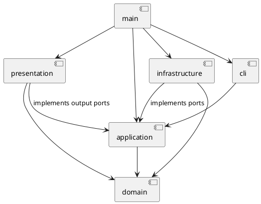

# PJ1 Phase 1：SVG CLI 编辑器项目文档

> 文档状态：第一部分架构初稿，等待用户审阅。以下明确区分计划与当前实现，不能视为最终验收声明。

## 一、架构方案

### 1. 目标与阶段边界

使用 TypeScript、面向对象和 Command 模式实现 CLI SVG 编辑器。最终包含作业要求的全部文档、编辑、显示及历史命令，内置 rect / circle / ellipse / line / text / g 六种图形。不实现后续阶段的 box 或动态插件加载。

遵守字段封装、一类一文件、文件名与类名一致；共享行为使用类层次与多态，不使用公共数据袋和散落的按图形标签分支。

### 2. 模块划分

| 目录 | 职责 | 第一部分状态 |
| --- | --- | --- |
| `src/cli/` | REPL、命令输入、分词、命令名到实现的分发 | REPL 与 registry 已实现；完整引号分词待实现 |
| `src/application/` | 会话、命令执行、撤销重做、外部能力接口 | Command 接口、HelpCommand、CommandError 已实现 |
| `src/application/commands/` | 每条命令独立的类 | 当前仅 HelpCommand |
| `src/application/ports/` | 文件和查询输出等接口 | 目录占位 |
| `src/domain/` | 文档树、图形类层次、id 索引和树约束 | 目录占位 |
| `src/infrastructure/` | 文件系统与 SVG XML 适配 | 目录占位 |
| `src/presentation/` | tree、show、帮助与反馈文本 | 当前仅 HelpText |
| `src/main.ts` | 创建对象、注入依赖、启动程序 | 已实现 |
| `tests/` | 单元、集成测试和输入样例 | 目录占位，无测试用例 |
| `examples/` | 可回放命令及示例 SVG | 目录占位 |

组件图的完整 PlantUML 源文件见 [architecture.puml](architecture.puml)。下图箭头表示编译期依赖，不表示运行时数据流。

### 3. 设计模式选择及落地计划

**Command（必选）**：命令对象封装一次操作，CLI 只分发，不直接修改模型。第一部分已有 Command 接口及 HelpCommand。第三部分加入 MoveCommand、GroupCommand 等编辑命令及历史执行契约；当前接口不代表撤销机制已经实现。

**Composite**：抽象 Shape 提供统一操作；Rect、Circle、Ellipse、Line、Text 实现叶子行为，Group 递归操作后代。文档根是结构容器，但不作为可供用户删除或分组的普通图形。第二部分实现。

**Memento**：历史管理器保存编辑前后的独立模型快照。恢复同时恢复层级、顺序、属性和 id 索引。失败不入栈；undo 后成功新编辑清空 redo。单次快照时间和空间为 O(N)，第一阶段优先选择可验证的正确性；后续可替换为差量记录。第三部分实现。

**Factory**：ShapeFactory 统一处理内置图形的创建及 SVG 元素读入，按名字选择具体类。各类自行处理几何和属性规则，调用方不按标签名重复判断。第二部分实现。

按名字分派仅允许两个集中位置，均标记为后续阶段待重构边界：

1. 命令分发：当前 `cli/CommandRegistry.ts` 中命令名到实现的 Map；后续将固定启动注册扩展为命令提供者注册。
2. 图形工厂：计划中的 `domain/ShapeFactory.ts`，类型名到类；后续支持 ShapeProvider 注册，但本阶段不建立完整插件系统。

属性名白名单是各图形的属性校验规则，不用于判断并分发图形类型。SVG 输出通过多态生成结构化元素表示，XML 适配器统一转义和编码，避免新增一套标签分支。

### 4. 依赖方向规则

| 模块 | 允许依赖 | 理由 |
| --- | --- | --- |
| domain | domain 内部及语言标准能力 | 保持图形行为与交互、存储无关 |
| application | application、domain | 表达用例，使用自己定义的端口接口 |
| cli | cli、application、Node 终端 API | 接收输入并调用命令，不修改领域结构 |
| presentation | presentation、domain | 读取模型，负责文本格式 |
| infrastructure | infrastructure、application 的端口、domain、Node 文件 API、XML 库 | 实现接口，把外部数据转换为模型 |
| main | 各模块公开入口 | 组合根，选择并注入具体实现 |

应用层若需要 tree/show 输出，通过 application/ports 中的查询输出接口接收适配器，避免 application 反向导入 presentation。presentation 可以实现该端口，增加的依赖仅指向 application 的接口。

禁止 domain 导入 application/cli/infrastructure/presentation，禁止 application 导入具体文件或 XML 实现，禁止 cli 越过应用层修改图形。发现违反规则的依赖时记入待处理项并修复。

### 5. 变化点假设

| 可能变化处 | 预留方式或暂不预留的理由 |
| --- | --- |
| 新增图形及未来 box | Shape 多态和集中工厂；本阶段不实现动态插件，避免超出范围 |
| 新增命令 | Command 接口和集中 registry，新增命令独立类 |
| CLI 以外的 GUI/agent 入口 | 图形和命令不直接依赖终端；后续入口复用应用层 |
| 文件来源与 XML 库变化 | 文件和编解码接口隔离具体实现 |
| 撤销存储方式 | 历史管理统一入口，快照可改为差量；不提前引入持久历史 |
| tree/show 排版 | presentation 独立，模型不拼接 CLI 树字符 |
| 完整 SVG 标准兼容 | 本阶段限定输入子集，暂不设计完整 CSS、路径和变换引擎 |

### 6. 关键语义与待确认细节

以下为审核方案沿用的实现约定，尚未实现：

- id 全局唯一、大小写敏感。读入时先收集显式 id，再生成不冲突的“标签名+序号”；成功加载后打印补 id 警告。
- 编辑失败不改变文档、历史、保存路径等状态。读入先构造候选文档，通过校验后整体替换。
- move 对容器递归修改后代几何坐标；scale 按原点同乘位置和尺寸，不额外修改 stroke-width 或字体大小。
- set g 的公共属性设置容器本身，遵循 SVG 继承，不覆盖子元素显式样式。
- group/addto 检查自包含、祖先后代冲突、重复参数和循环；叶子与容器统一寻址。
- 跨父容器 group：新组放在最近公共容器中，子节点按原文档顺序排列；插入到最早受影响的直接子分支之前。其他原父容器保留，即便变为空容器。实现前用具体样例验证规则。
- ungroup 按作业明确规定拒绝解散根级容器；合法解散时孩子占据原组位置。
- front 将节点移至同级列表末尾，back 移至开头，符合 SVG 绘制顺序。
- 成功的 init/read/save/canvas 尺寸修改清空历史并设屏障；undo/redo 输出指定禁用错误，直到下一次成功编辑开始新的历史。失败操作和查询不改变历史。
- save 指定新路径成功后更新当前保存路径。无参数且没有路径时给出用法错误。
- 只保证六种元素及规定属性的读写。未知且会影响结果的结构、属性或变换明确报错，不静默丢弃；完整 transform/CSS 等支持不纳入默认范围。最终支持子集须在第五部分落实并列明。
- # 只有在一行的首个非空白字符位置才表示注释，颜色 #4a90d9 是普通参数。双引号参数由后续独立分词器处理。

## 二、过程记录

### 2026-10-25：需求阅读与方案审核

- 用户先要求阅读作业并给出方案，审核前不编码。
- AI 提出六阶段方案、Command + Composite + 快照撤销、依赖规则及测试计划；指出 box 属后续阶段、顶层 ungroup 禁止、SVG 导入范围需明确。
- 用户同意按方案分步实现，要求在 VS Code 中操作，每完成一部分由用户审阅后继续。

### 2026-10-25：第一部分，项目骨架

- 检查本机具有 VS Code、Node.js 24.13.0、npm 11.6.2 和 Git 2.52.0；目标目录起初无代码、无 Git 仓库。
- 建立独立工程、严格 TypeScript 配置、VS Code 任务与调试配置、最小 REPL、Command 接口和 help 实现。
- 当前仅注册 help，帮助明确列出其他命令仍为计划。没有用空实现伪装已完成的图形功能。
- 首次依赖安装遇到默认 npm 缓存目录写权限限制，改用工程外的 work/npm-cache；没有修改系统权限。
- 编译后 CLI 运行成功，但 tsx 源码启动因受限环境的 uv_os_get_passwd 调用失败。改为 tsc 编译后使用 Node 运行，删除 tsx 依赖；F5 同样在构建后运行，并保留 source map 断点支持。
- VS Code 打开命令已执行，但当前工具未能确认桌面窗口；不将后台终端检查记作 VS Code 界面验收。F5、任务快捷键与可见窗口由用户审阅时确认。
- 用户尚未审阅本部分；不能记录为已通过。最终验证结果见下方阶段检查记录。

## 三、一致性自查

当前仅进行第一部分检查，最终实现后逐项复查：

| 项目 | 当前事实 | 后续检查 |
| --- | --- | --- |
| 模块划分 | 已按计划创建目录；未实现目录用 .gitkeep 保留 | 检查实际代码职责，偏差写入修订记录 |
| 依赖方向 | 已检查当前全部生产代码 import，符合规则 | 实现后检查所有生产代码及外部依赖 |
| Command | 有公共接口和 HelpCommand | 验证所有编辑经过历史执行器 |
| Composite | 未实现 | 验证同一命令处理叶子与嵌套组 |
| 两处分派 | 当前仅存在命令 registry | 工厂落地后检查无其他按类型分派 |
| 一类一文件 | 当前类各有独立同名文件 | 逐阶段检查 |

修订记录：第一部分把已有 Command 定位为调用接口，撤销契约延后到第三部分；这与分阶段计划一致。后续出现架构变化时记录原因与影响，不改写过去讨论记录。

## 四、功能完整性与质量保证手段

### 1. 当前功能覆盖

| 功能组 | 状态 |
| --- | --- |
| REPL、svg>、help、空行、整行注释、错误后继续读取 | 第一部分实现，后台终端冒烟验证通过 |
| 六种图形、文档模型、树约束 | 第二部分计划 |
| 编辑命令、历史、失败回滚 | 第三部分计划 |
| 完整分词、tree/show、全部帮助语法 | 第四部分计划 |
| SVG 文件读写、缺 id 补齐、示例 | 第五部分计划 |
| 最终验收、远程提交、final 标签 | 第六部分计划 |

### 2. 计划中的验证手段

- 编译期：strict、noUncheckedIndexedAccess、exactOptionalPropertyTypes 等检查，构建与源码运行分别验证。
- 第二部分起使用 Vitest 测试模型行为，当前尚未安装测试依赖，也没有声称测试通过。
- 单元验证：六种几何、属性白名单、唯一 id、嵌套结构、环检测、顺序保持。
- 历史验证：每种编辑命令一个撤销单元、redo 分叉、失败状态不变、I/O 屏障。
- 集成验证：真实 CLI 输入输出、带空格文本、颜色与注释、作业案例脚本。
- 文件验证：特殊字符与中文、缺 id/重复 id、损坏 XML、不可读写文件、save/read 往返语义一致。
- 视觉验证：浏览器打开输出 SVG，核对流程图实际显示。
- 架构验证：抽查并扫描 import、类型分派和类文件对应关系。

### 3. 分阶段提交与交付

1. 工程骨架和架构初稿。
2. 图形与文档模型。
3. 编辑命令和历史管理。
4. 完整 CLI 与显示。
5. SVG 读写和完整场景。
6. 验收、文档修订与最终版本。

每阶段实际实现后提交，保留修复迭代的真实记录。远程仓库地址、推送与截止时间待补；当前不创建 final 标签，最终验收后在最终提交上创建并推送。

### 4. 第一部分检查记录（2026-10-25）

| 检查 | 结果与边界 |
| --- | --- |
| `npm run typecheck` | 通过 |
| `npm run build` | 通过，生成 dist 与 source map |
| `npm run cli` | 通过，实际执行编译并进入 REPL |
| 编译后 `node dist/main.js` | 通过 |
| help、空行和整行 # 注释 | help 输出阶段状态，空行和注释无业务反馈 |
| 未知命令、`help extra` | 分别输出 `error: unknown command: unknown`、`error: usage: help` |
| 错误后再执行 help | 正常输出，错误不会终止会话 |
| 管道 EOF | 正常结束，进程退出码 0 |
| import 检查 | 当前 CLI 只依赖应用层及 Node 终端 API；HelpCommand 不依赖 CLI 或具体输出实现 |
| 依赖安装 | 锁文件已生成；安装报告 0 个已知漏洞，此项不代表完整安全审计 |
| VS Code 可见窗口、F5 和交互键盘 | 未验证，需用户审阅；已提供打开路径及配置 |
| 图形、编辑、SVG 读写、历史 | 尚未实现，未执行对应验收 |

以上为后台终端检查，并非完整 Phase 1 验收。当前没有自动化测试用例；第二部分起补充模型行为测试。
